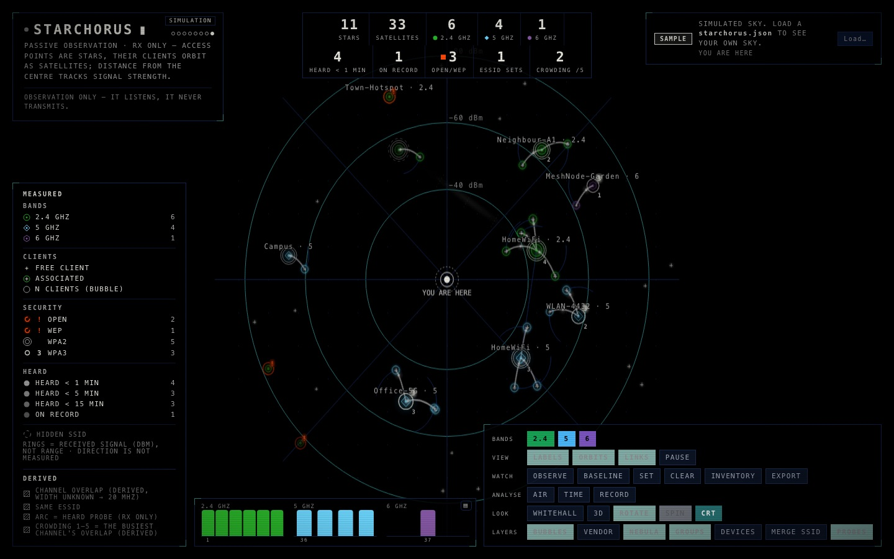
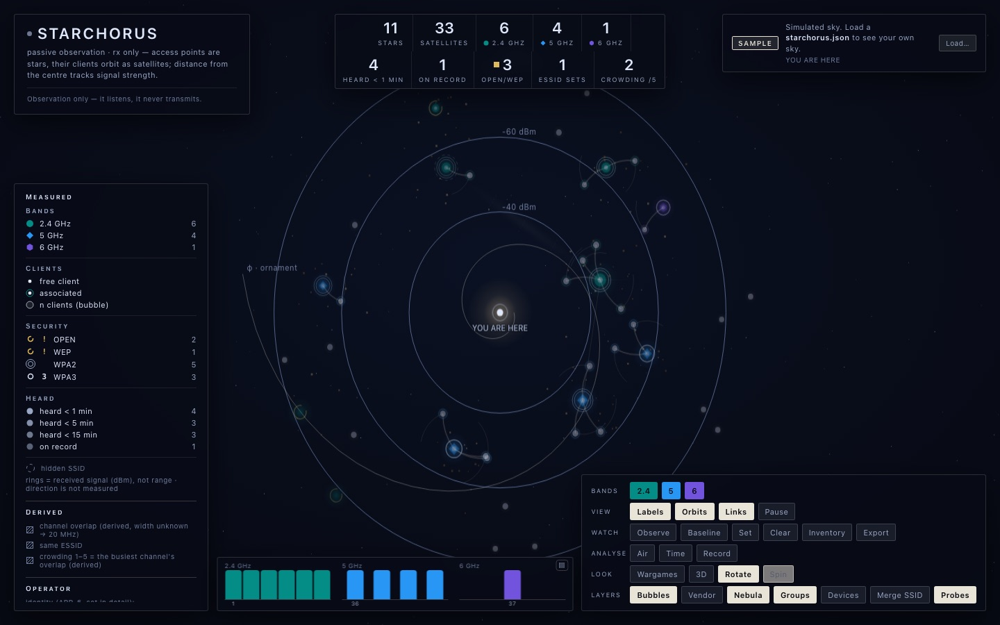
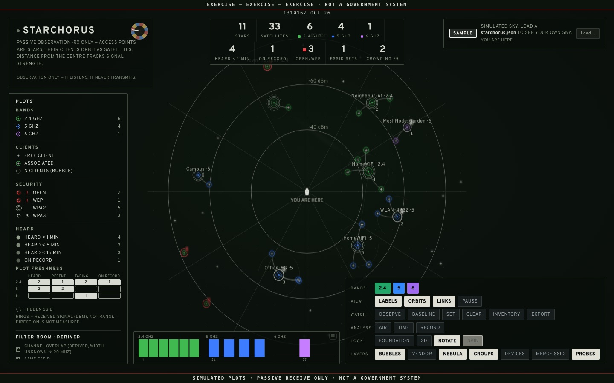
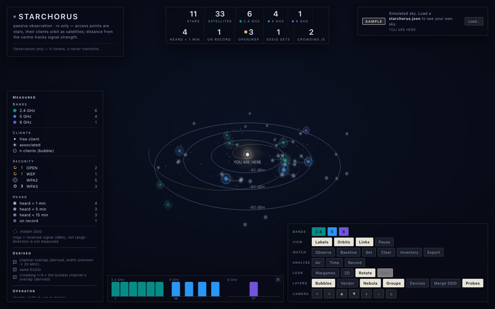

  

<h1 align="center">Starchorus</h1>

<b>Instruments for seeing the networks around you.</b> 
<i>The air is full of radio. We draw it.</i>

---

Every room you walk into is crowded with networks you cannot see: routers, repeaters, telephones
asking after networks they once knew. The usual tools describe all this in tables, accurate,
exhaustive and very nearly unreadable. Starchorus draws it instead, as a sky that turns slowly about
you, and every mark in that sky still answers to a measurement.

## Pager

**[starchorus/pager](https://github.com/starchorus/pager)** turns a Hak5 WiFi Pineapple Pager into
an observatory. Access points are stars, coloured by band; their clients orbit as satellites; the
stronger the signal, the closer to the centre. It listens and never transmits.

<table>
  <tr>
    <td width="33%"></td>
    <td width="33%"></td>
    <td width="33%"></td>
  </tr>
  <tr>
    <td align="center"><b>Foundation</b>: the quiet chart</td>
    <td align="center"><b>Whitehall</b>: the plotting table</td>
    <td align="center"><b>Orbit</b>: the sky in three dimensions</td>
  </tr>
</table>

One self-contained page, three looks, two and three dimensions; baseline comparison, inventory,
air quality, signal over time, recording and replay, and a homing meter. GPL-3.0-or-later.

## Mac

The machines on your local network, drawn in the same manner, as a native macOS application.
*In preparation.*

## How the work is done

- **Passive by design.** What can be learnt by listening is learnt by listening.
- **Exact rather than impressive.** A figure on the screen can always be traced to its source.
- **Quiet.** No telemetry, no accounts, no calls home.
- **Judged on the work.** Contributions stand or fall on their merit.

## On screen

Starchorus is at home in front of a camera. Its demonstration mode shows a convincing sky made of
simulated data and placeholder names, and so discloses nothing about anyone: ready for on-set
playback and screen graphics in film and television, as it stands.

## Enquiries

Commercial licensing and production enquiries are welcome; please use the 'Question or contact'
form in the relevant repository.

---

All images show the built-in demonstration: simulated data, placeholder names, no real
environment. Hak5, WiFi Pineapple and WiFi Pineapple Pager are trademarks of Hak5 LLC. Starchorus
is an independent project and is not affiliated with, sponsored or endorsed by Hak5.
